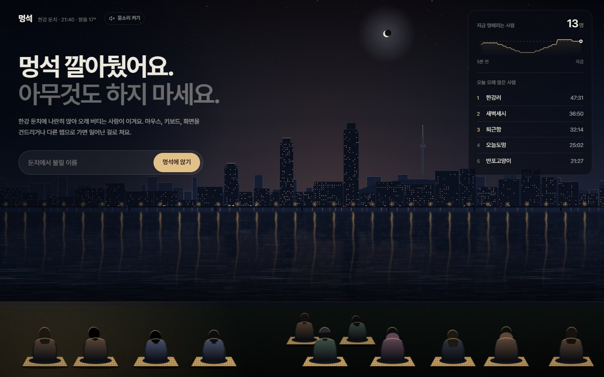
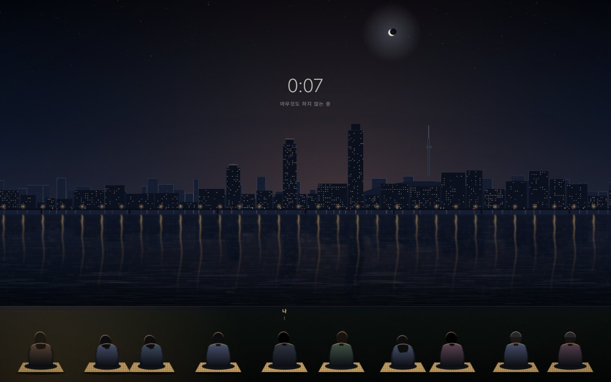
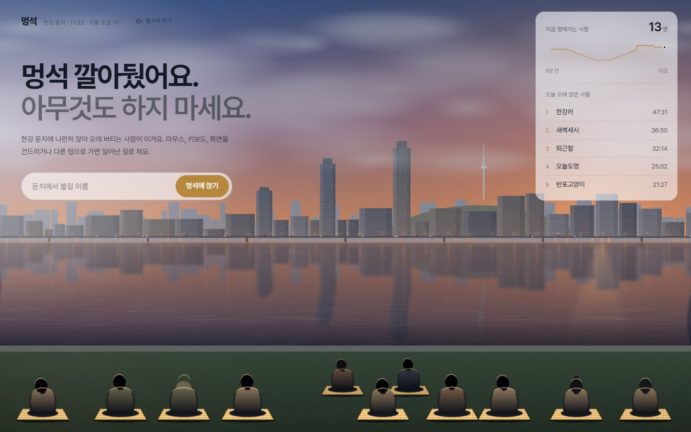
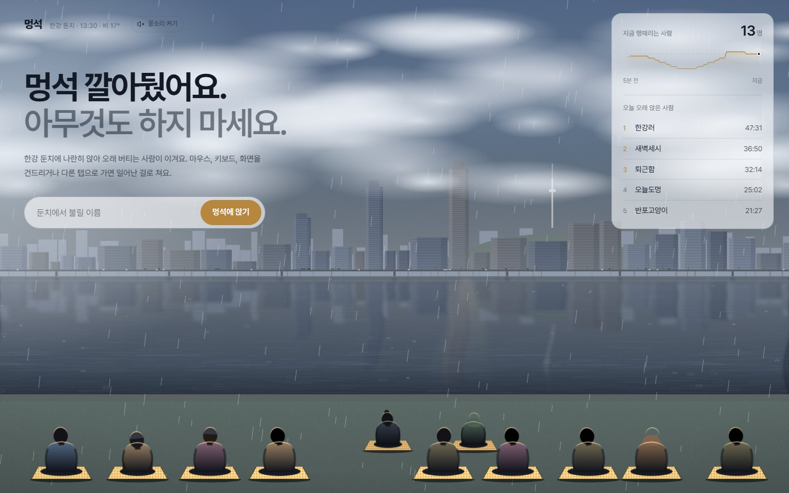
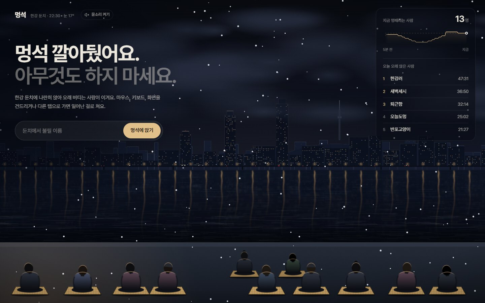
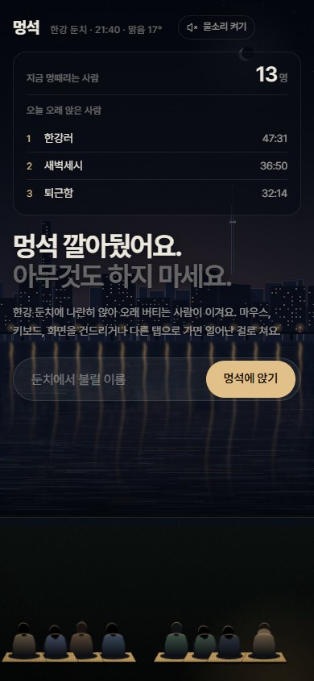

# 멍석

**한강 둔치에 멍석 깔아뒀어요. 앉아서 아무것도 하지 마세요.**

멍석은 브라우저에서 바로 들어가는 온라인 한강 둔치예요. 이름을 적고 멍석에 앉으면, 지금 접속한 다른 사람들과 나란히 앉아 강을 바라보게 돼요. 마우스도, 키보드도, 화면도 건드리지 않고 오래 버티면 이겨요.

## 이렇게 놀아요

1. **이름을 적고 멍석에 앉아요.** 가입도 설치도 없어요.
2. **아무것도 하지 마세요.** 앉는 순간 글자들이 사라지고 강과 시계만 남아요. 마우스를 움직이거나, 키를 누르거나, 화면을 만지거나, 다른 탭으로 가면 일어난 걸로 쳐요.
3. **얼마나 버텼는지 확인해요.** 오늘 가장 오래 앉은 사람들의 순위에 이름이 올라가고, 기록을 친구에게 공유할 수 있어요.

## 한강은 지금 서울과 같아요

하늘은 서울의 시간과 실제 날씨를 따라 바뀌어요. 아침에는 해가 뜨고, 저녁에는 노을이 지고, 밤에는 다리 불빛이 강물에 길게 비쳐요. 서울에 비가 오면 둔치에도 비가 내리고, 눈이 오면 눈이 쌓여요.

| 노을 | 비 오는 낮 |
|---|---|
|  |  |
| **눈 오는 밤** | **휴대폰에서** |
|  |  |

## 그 밖에

- **함께 있지만 말은 없어요.** 같은 둔치에 앉은 사람들의 뒷모습만 보여요. 한 둔치에 30명이 차면 옆 둔치가 열려요.
- **물소리.** 버튼을 누르면 강물 소리가 흘러요. 비 오는 날에는 빗소리가 섞여요.
- **가끔 "아직 계세요?"** 오래 앉아 있으면 한 번씩 조용히 물어봐요. 눌러도 일어난 걸로 치지 않아요. 자리를 비운 사람이 순위를 가져가지 않게 하려는 장치예요.
- **한 네트워크에 한 명.** 같은 네트워크에서 새로 들어오면 이전 화면은 닫혀요.
- **고운 이름만.** 욕설이나 광고가 들어간 이름으로는 앉을 수 없어요.
- **순위는 매일 자정(한국 시간)에 새로 시작해요.** 한 사람당 그날 가장 좋은 기록 하나만 남아요.

## 만든 재료

React · Vite · Tailwind CSS · shadcn/ui · [Motion](https://motion.dev) · [Anime.js](https://animejs.com) · [Bklit UI](https://bklit.com) · Canvas 2D · Web Audio · Cloudflare Workers / Durable Objects · [Open-Meteo](https://open-meteo.com) (날씨) · [Pretendard](https://github.com/orioncactus/pretendard) (글꼴)

스크린샷의 순위와 인원 그래프는 소개를 위한 예시예요.
